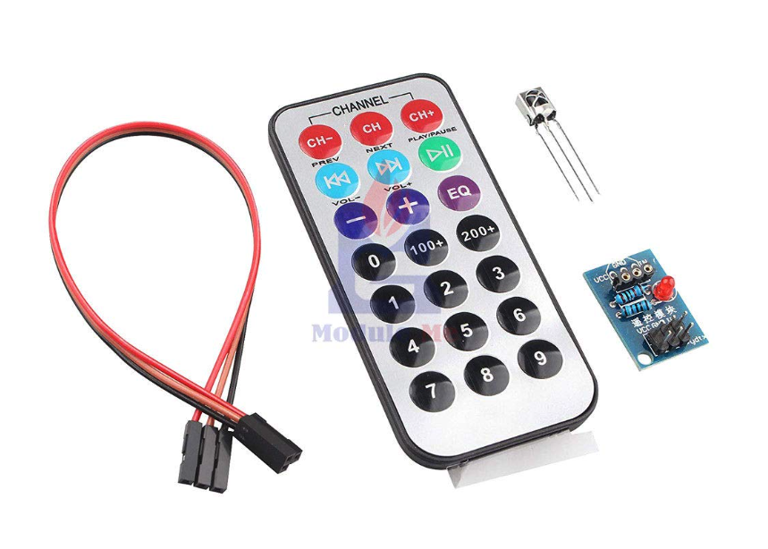
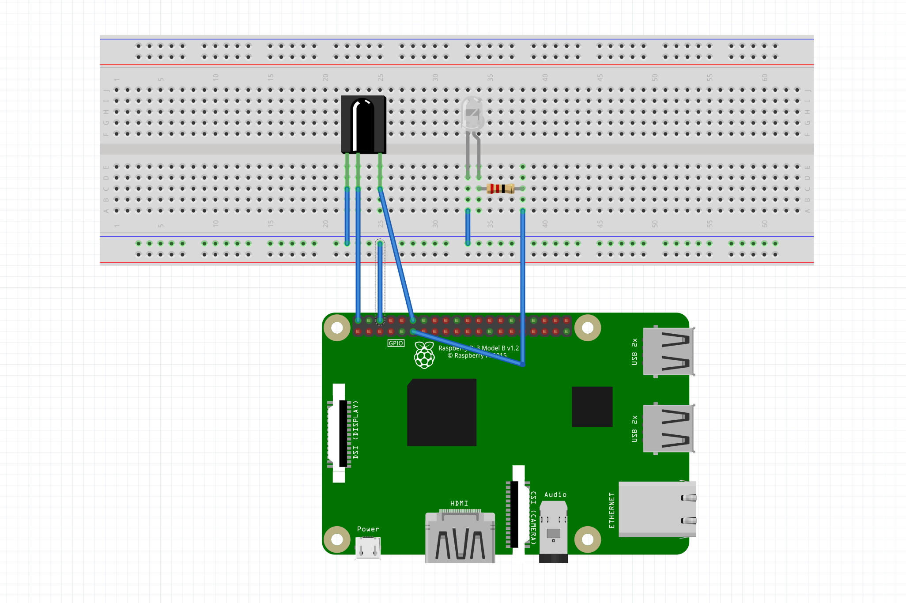

我有一个便携式空调放在客厅，天热的时候需要开着卧室的门睡因为卧室里面没发放空调，所以就想用树莓派来弄一个空调遥控器。这样加一个简单的后台就可以直接用手机遥控，实现一个超简易版“智能家居”。

## 准备工具

1. 树莓派
2. 红外接收管 HS0038B
3. 红外发射管 TSAL6200
4. 空调
5. 空调遥控器



其中 红外接收管 和 红外发射管 在美国不太容易买到，可以在亚马逊上买这种一套，然后把塑料遥控器剪开拿里面的发射管就好

## 硬件连接

红外接收管信号输出脚 -> GPIO18  
红外发射管正极 -> GPIO17

> 电阻随便加一个限流就好



## 安装

```
sudo apt update
sudo apt install lirc
```

## 修改config.txt

修改文件 /boot/config.txt# ：

```
sudo vim /boot/config.txt
```

修改 infrared communication 部分，修改为：

```
# Uncomment this to enable infrared communication.
dtoverlay=gpio-ir,gpio_pin=18
dtoverlay=gpio-ir-tx,gpio_pin=17
```

修改驱动(LIRC)配置：

```
sudo vim /etc/lirc/lirc_options.conf
```

```
# 找到
driver = devinput
device = auto
# 修改为
driver = default
device = /dev/lirc1
```

修改完后重启树莓派。

```
sudo reboot now
```

## 测试链接是否正常

重启之后 `/dev` 目录下会多出两个 lirc文件 `lirc0` `lirc1`，分别 对应发射管和接收管

```
pi@raspberrypi:~ $ ls /dev|grep lirc
lirc0
lirc1
```

### 红外发射管检测

通过命令给红外发射管一个高电平

```
gpio write 0 1
```

这时发射管会被点亮，不过由于人眼看不见红外线，这里可以借助手机相机查看红外发射管是否处于发光状态。然后关掉发射管

```
gpio write 0 0
```

### 红外接收管检测

然后检测红外接收管

```
# 必须停止lircd服务才能进入接收红外信号模式
sudo service lircd stop
mode2 -d /dev/lirc1
```

用遥控器对着红外接收管按下一个键，如果得到如下形式的输出就表示正常：

```
sing driver default on device /dev/lirc1
Trying device: /dev/lirc1
Using device: /dev/lirc1
pulse 44
timeout 27327
pulse 133
timeout 28081
pulse 9041
space 4478
pulse 582
space 552
pulse 562
space 1680
pulse 585
space 547
```

## 录入红外信号

进入红外接收模式：

```
mode2 -m -d /dev/lirc1
```

然后按下遥控器上的“开”按钮，得到以下输出：

```
pi@raspberrypi:~ $ mode2 -m -d /dev/lirc1
Using driver default on device /dev/lirc1
Trying device: /dev/lirc1
Using device: /dev/lirc1
 16777215

     9042     4481      582      524      610     1653
      587      545      561      580      553      571
      589      544      594      542      584     1653
      586     1654      588      544      561     1680
      589     1663      551     1679      591     1651
      586     1654      590      543      588      549
      583      546      590      542      587     1654
      587      546      588     1652      562     1687
      558      569      599     1640      562     1679
      590     1652      588      544      588     1660
      581      544      588      545      588     1653
      588    13339-pulse    63245-space

    39763-space

     9049     2232      588    31692-pulse
```

上述输出，删除第一个很大的数字16777215及前面的内容以及 `xxxx-pluse`和`xxxx-space` 格式的内容，然后复制，就得到了“开空调”的红外信号。

接下来，创建配置文件：

```
sudo vim /etc/lirc/lircd.conf.d/aircon.lircd.conf
```

填入以下内容：

```
begin remote

    name  aircon
    flags RAW_CODES
    eps            30
    aeps          100

    gap          19991

    begin raw_codes
        name on
            9042     4481      582      524      610     1653
            587      545      561      580      553      571
            589      544      594      542      584     1653
            586     1654      588      544      561     1680
            589     1663      551     1679      591     1651
            586     1654      590      543      588      549
            583      546      590      542      587     1654
            587      546      588     1652      562     1687
            558      569      599     1640      562     1679
            590     1652      588      544      588     1660
            581      544      588      545      588     1653
            588    

  end raw_codes

end remote
```

保存配置文件后，需要重启LIRC服务才能生效：

```
sudo systemctl restart lircd
```

测试开空调指令是否生效：

```
irsend SEND_ONCE aircon on
```

上述命令中，aircon是遥控器名称，对应配置文件中的name aircon；on是遥控器的指令，对应配置文件中begin raw\_codes后面的name on。指令执行后，如果没有任何输出，说明指令正确执行了，正确情况下空调应该“嘀”的一声，然后打开了。如果空调没有反应，可以打开手机摄像头，对准红外发射管，再次执行开空调指令，并观察红外发射管是否闪动。如果能观察到闪动，说明信号已经发射出去，可以考虑将红外发射管移近空调（测试时4米可以控制，偶尔失灵）。  
如果执行指令后，提示找不到遥控器：

```
unknown remote: "aircon"
Error running command: Input/output error
```

说明配置文件格式不对.

### 录制其它按钮

接下来可以按照同样的方法录制更多红外信号，比如关空调，升温，降温等。需要注意的是有些空调红外遥控器会把每个状态都对应一个红外信号。比如现在是23度，按下 + 键 空调变为24度 并获得了红外信号。 通过自己的设备重新发送一遍红外信号会发现空调还是24度，并没有变成25度。对于这种情况就需要把自己的常见温度录制一遍。  
我的空调比较蠢，垃圾意大利货开和关的信号都是一样的，而且还只有+ 和 - 两个信号控制升温和降温，所以我录制三个信号就可以覆盖使用场景了。

## Reference

<http://www.maoyingdong.com/dorzy/>

<https://segmentfault.com/a/1190000014135418>
